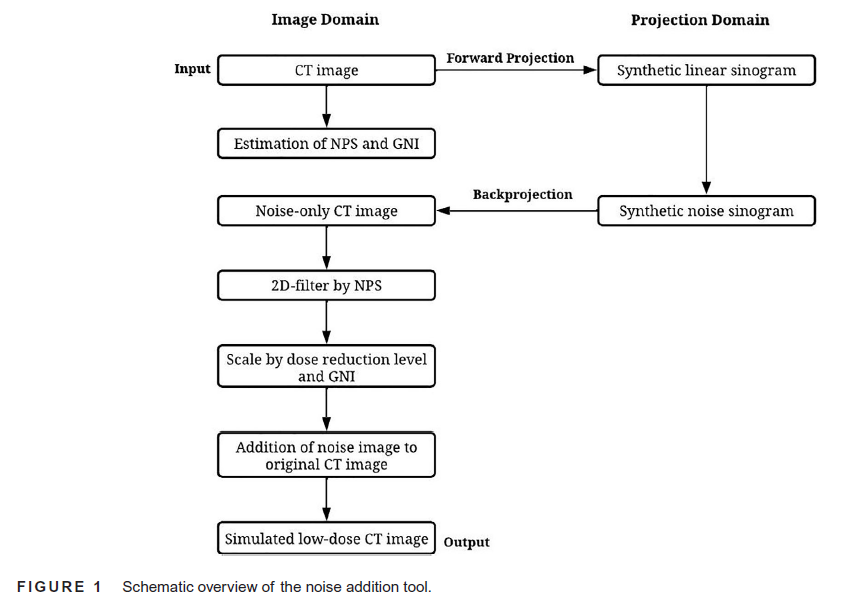

# LDCT from CT Images without Vendor's Sinograms

*Adapted from: Alsaihati, N., Solomon, J., McCrum, E., & Samei, E. (2024). Development, validation, and application of a generic image‐based noise addition method for simulating reduced dose computed tomography images. Medical Physics. https://doi.org/10.1002/mp.17444*


  

---
### Running the LDCT Simulation

#### 1. Prepare the Configuration File

##### Example of `LDCT_config.yaml`

```yaml
output_dir: "/data/LDCT_Sim/1mm_B30/L506"
dicom_folder: "/data/B30_full_1mm/full_1mm/L506/full_1mm"
ldct_numpy_filename: "ldct_sim_1mm_B30_L506_QD.npy"
ldct_nrrd_filename: "ldct_sim_1mm_B30_L506_QD.nrrd"

f: 0.25
beta: 0.5
use_gpu: True
```
###### Parameter description:
  
- **`output_dir`** → Path where simulated LDCT outputs will be saved.  
- **`dicom_folder`** → Path to the original full-dose DICOM series. 
- **`ldct_numpy_filename & ldct_nrrd_filename`** → Output filenames for the simulated LDCT data.   
- **`f`** → is the dose scaling factor, where `f = 0.25` represents a simulated low-dose CT at 25% (quarter dose) of the original.
- **`beta`** → Scalar determining the assumed power relationship between radiation dose and noise.  
- **`use_gpu`** → Enables GPU acceleration if available.

##### Running the container
After preparing your configuration file (e.g., `LDCT_config.yaml`), you can run the simulation using Docker.
Use the command below and update only:

- the `-v` paths to match where your data is located
- the YAML file name after `--config`

###### Example command
```bash
docker run --rm --gpus all \
  -v /data:/data \
  -v "$(pwd)":/app \
  ldct_alsaihati --config /app/LDCT_config.yaml
```
###### Explanation

- **`--rm`** → automatically removes the container after it finishes running.  
- **`--gpus all`** → enables GPU access (requires the NVIDIA Container Toolkit).  
- **`-v <host_path>:<container_path>`** → mounts a folder from your local machine into the container.  
  - The example above uses `/data` as a local directory — **replace this with the path where your own data is stored.**
  - `$(pwd):/app` mounts your current working directory (so Docker can read your config file).  
- **`ldct_alsaihati`** → the name of the Docker image.  
- **`--config /app/LDCT_config.yaml`** → path (inside the container) to your configuration file.

##### Resuming from a Specific Step or stopping after a specific step:

### Example command

To **start from step3** instead of the beginning:

```bash
docker run --rm --gpus all \
  -v /data:/data \
  -v "$(pwd)":/app \
  ldct_alsaihati --config /app/LDCT_config.yaml --start-at step3
```
To **stop after step2**:
```bash
docker run --rm --gpus all \
  -v /data:/data \
  -v "$(pwd)":/app \
  ldct_alsaihati --config /app/LDCT_config.yaml --stop-after step2
```
This is recommended to examine the NPS Graph, and if earlier steps have already completed and you don’t want to start over.

Each step corresponds to one of the following IDs:
- **step0** → DICOM to NumPy conversion  
- **step1** → GNI preprocessing  
- **step2** → NPS computation  
- **step3** → Forward projection  
- **step4** → Add noise  
- **step5** → Back projection  
- **step6_1** → NPS noise image generation  
- **step6_2** → Filter noise  
- **step7_1** → Noise GNI  
- **step7_2** → Scale noise  
- **step8_1** → Save LDCT as NumPy  
- **step8_2** → Save LDCT as NRRD


---
## Theoretical Background:

### 1. Estimating GNI:
The Global Noise Index (GNI) represents the mode of the distribution of local standard deviation values within soft-tissue regions of a CT image, quantifying the image’s overall noise magnitude per slice.\
In Alsaihati et al. (2024), the GNI profile obtained using Christianson’s method was smoothed with a moving-average filter to minimize slice-to-slice fluctuations caused by statistical variability.

### 2. Estimating NPS:
Noise in CT images exhibits spatial correlation, resulting in a characteristic texture.\
While the GNI quantifies noise magnitude, the Noise Power Spectrum (NPS)—the Fourier transform of the noise autocorrelation function—describes how noise variance is distributed across spatial frequencies, reflecting its texture.\
In Alsaihati et al. (2024), the NPS was estimated from multiple uniform ROIs within CT images, averaged, and fitted with an analytical Weibull-based function to represent the measured spectrum compactly.\
This analytical NPS was later used to filter synthetic noise, ensuring that simulated reduced-dose images reproduced realistic texture and frequency characteristics of the original CT data.

### 3. Synthetic Sinogram Generation:
A sinogram represents projection data acquired at multiple rotation angles before image reconstruction.\ 
In this tool, synthetic sinograms were generated by forward-projecting reconstructed CT images (converted from Hounsfield units to linear attenuation coefficients) using the ASTRA toolbox. The acquisition geometry was approximated from DICOM header parameters, replicating the scanner’s geometry without requiring access to raw data.

### 4. Noise Sinograms:
A separate random noise sinogram was created, containing zero-mean Gaussian noise scaled according to the attenuation levels of the synthetic projections and shaped by the bowtie filter geometry. This approach ensured that regions with higher attenuation received appropriately scaled noise, reflecting realistic spatial variations in CT acquisition.

### 5. Backprojection of Noise:
The noise sinogram was back-projected onto an image matrix corresponding to the original CT slice using the ASTRA toolbox, producing a “noise-only” image.\
This step transformed projection-domain noise into the image domain, preserving spatial nonuniformities and anatomical correlations characteristic of CT reconstruction.

### 6. Filtering:
Because power in the frequency domain is proportional to the square of amplitude, the frequency content of an image can be shaped by adjusting the amplitudes of its Fourier components.\
This step refines the noise-only image by applying a frequency-dependent scaling factor derived from the square root of the ratio between the analytical NPS of the reference CT data and the measured NPS of the synthetic noise, expressed as $\sqrt{\frac{NPS_{analytical}}{NPS_{noise}}}$\
where NPS_analytical(f) represents the target noise spectrum modeled using the fitted Weibull function from the original CT images, and NPS_noise(f) is the spectrum of the back-projected noise image.\
While Alsaihati et al. (2024) describes applying only the square root of the analytical NPS, our implementation additionally normalizes by the spectrum of the back-projected noise image to compensate for spectral distortions introduced during back-projection. This modification was found to substantially improve the consistency of our results with the paper’s example of the filtered noise appearance. Residual correlations may remain due to discretization and isotropic filtering assumptions, our data was not good when we did not use that.
### 7. Scaling to the Target Dose

As described in *Alsaihati et al.* (2024), the filtered noise image is scaled to achieve the desired dose reduction while preserving the slice-wise noise characteristics of the input data. Following the inverse noise–dose relationship:

$$ 
\sigma \propto D^{-\beta}
$$ 

(with β ≈ 0.5 for FBP), the target slice noise is

$$
\sigma_{tar}(k) = \sigma_{in}(k) \cdot f^{-\beta}
$$

where $\sigma_{tar}(k)$ is the target noise magnitude of slice k, $f = \frac{D_{out}}{D_{in}}$ is the dose ratio and $\sigma_{in}(k)$ is the smoothed GNI from Step 1.\
Because in algebra two quantities that are directly proportional satisfy $a = C*b$, where $C$ is the constant of proportionality, the proportionality between noise and dose introduces a scaling constant in the equation below. 
Assuming the synthetic and original noise are independent (so their variances add),\
$$
\sigma_{tar}^2(k) = \sigma_{in}^2(k) + (a_k \cdot \sigma_{N,raw}(k))^2
$$

the per-slice scaling factor becomes

$$
a_k = \sqrt{f^{-2\beta} - 1} \cdot \frac{σ_{in}(k)}{σ_{N,raw}(k)}
$$

where  a<sub>k</sub> represents the scaling factor applied to the synthetic noise for slice k, σ<sub>N,raw</sub>(k) is the GNI measured from the filtered noise image.

Each noise slice is multiplied by its scaling factor a_k to produce the final scaled noise, which is added to the input CT slice to form the simulated reduced-dose image.

### 8. Adding the filtered and scaled noise image to the original image
In this step the result from the seventh step is added to the original ct_array, and it gets saved as a numpy array and as a nrrd file.

---
##  Our Patient Image Validation

Following the same methodology as the original paper, the tool was validated using **x data** .

### Dataset info:
- **Reconstruction method:** FBP  
- **Kernels used:** B30 and D45  
- **Slice thickness:** 1 mm and 3 mm  
- **Number of images:** 9  
- **Dose reduction factor:** applied using β = 0.5 for FBP  

###  Regions of Interest (ROIs)
For each image, **3 ROIs** were analyzed across three anatomical regions:
- Descending aorta  
- Left kidney  
- Liver  

### 📊 Evaluation Metric
The **percent error in noise magnitude** was calculated for each ROI using:

$$
\delta (\%) = \frac{\sigma_{\text{sim}} - \sigma_{\text{actual}}}{\sigma_{\text{sim}}} \times 100
$$

where **σ** is the standard deviation (STD) of pixel values.


---
## Known Limitations of the Noise-Addition Tool

### Physics & System Modeling
- **Electronic noise not modeled**  
  May be less accurate for very low-dose scans or large patients where electronic noise matters.
- **Detector-correlated noise not modeled**  
  Only the overall noise pattern is accounted for.
- **Back-projection noise correlations**  
  Back-projected white noise can introduce extra correlations that may be over-represented.
- **Challenges with low-frequency kernels**  
  Estimating the noise power spectrum (NPS) for these kernels can be inaccurate.

### Acquisition & Protocol Dependencies
- **Angular tube current modulation (TCM) not included**  
  Noise variation within each slice from angular TCM is not simulated.
- **Limited protocol testing**  
  Evaluated on one clinical protocol; performance may vary for other settings (e.g., kVp, anatomy, metal implants).

### Reconstruction & Algorithmic Behavior
- **Iterative reconstruction (IR) noise not fully captured**  
  Models global noise behavior well (like FBP), but not local non-stationary noise seen in IR.
- **β parameter estimation**  
  β (dose-noise relationship) may need tuning or reference values for different reconstruction algorithms.

### Validation Constraints
- **Validation scope**  
  Noise texture validated mostly on phantoms; patient texture evaluation was limited.

---